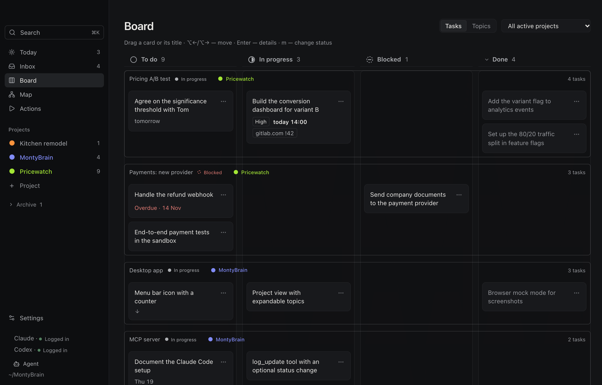

<div align="center">

# MontyBrain

**Your projects, tasks, and coding agents. One local workspace.**

A macOS app and MCP server built around plain Markdown files.
Keep the context of your work between sessions with Claude Code and Codex.

[Website](https://montybrain.com) · [Getting started](#getting-started) · [Contributing](CONTRIBUTING.md) · [MIT license](LICENSE)

</div>



## Why MontyBrain?

You finish a coding session. Tomorrow, the tasks, decisions, and next steps should still be there.
MontyBrain keeps them in a folder you own, with a desktop app for you and an MCP server for your agents.

- **Projects → topics → tasks.** Group work by project, keep a summary and a journal for each topic, and connect it to your repositories.
- **A clear view of today.** See overdue work, deadlines, tasks in progress, and blockers. Switch to a board or a dependency map for the bigger picture.
- **Capture without switching context.** A global shortcut opens quick capture. Use the menu bar, reminders, and keyboard navigation throughout the app.
- **Agents share your context.** Claude Code and Codex can read tasks, update their status, and leave a journal entry through MCP. The app picks up file changes.
- **Plain files, by design.** Read and edit your data in a text editor. Back it up with your usual tools or keep it in a separate Git repository.
- **Open source under MIT.** Use it, change it, and help shape what comes next.

The interface defaults to **English**, with **Polish** available in **Settings → App language**. Your choice is saved on this computer and applies to both windows, the menu bar and notifications. Commands accept English aliases such as `/topic`, `/wait`, `/link`, `!high`, `!low`, `@today`, `@tomorrow` and `@fri`; Polish commands remain supported. The website and project documentation are in English. Desktop support currently targets **macOS**; Windows and Linux desktop builds are not provided. This is an early project, so expect changes.

## Getting started

### Download the app

Visit **[montybrain.com](https://montybrain.com/#download)** for available macOS builds and installation instructions.
[Browse GitHub Releases](https://github.com/bartlomiejmont/montybrain/releases) for published builds. If no release is available yet, build from source as described below.

Release packages are designed to contain `MontyBrain.app`, the matching `montybrain-mcp` binary, the agent skills, and installation instructions. Choose **Apple Silicon** for M-series Macs or **Intel** for Intel Macs. Builds produced by the supplied workflow are not Apple Developer signed or notarized; macOS may block the first launch. See [Apple's instructions for opening an app from an unidentified developer](https://support.apple.com/guide/mac-help/open-a-mac-app-from-an-unknown-developer-mh40616/mac).

### Build from source

You need macOS, [Xcode Command Line Tools](https://developer.apple.com/xcode/resources/), [Rust](https://rustup.rs/) **1.89+**, Node.js **22.12+**, and pnpm **10**.

Source repository: [bartlomiejmont/montybrain](https://github.com/bartlomiejmont/montybrain).

```sh
git clone --depth 1 https://github.com/bartlomiejmont/montybrain.git montybrain
cd montybrain
pnpm install --frozen-lockfile
pnpm tauri build --bundles app
open target/release/bundle/macos/MontyBrain.app
```

A shallow clone skips the old commit history. It still downloads the current source and screenshots. Build tools also download their dependencies. To work on the app interactively:

```sh
pnpm tauri dev
```

`pnpm dev` runs the frontend with demo data in a browser; it does not open your real vault.

### Connect your coding agent

From the source checkout, run:

```sh
./install.sh
```

This builds the MCP server, installs it to `~/.local/bin/montybrain-mcp`, registers it with the installed Claude Code and Codex CLIs, and copies the four bundled skills. Start a new agent session afterward.

```sh
./install.sh --only claude                 # Claude Code only
./install.sh --only codex                  # Codex only
./install.sh --vault /absolute/path/vault  # choose a different data folder
./install.sh --status                      # inspect the installation
./install.sh --uninstall                   # remove MCP registration and managed skills
```

The uninstall command leaves your vault and MCP binary in place. You can also use the standalone MCP server without the desktop app; see its [setup guide and tools](crates/mcp/README.md).

Try asking your agent:

> Show me what is overdue, summarize the active topics, and suggest the next task.

> Record what we finished in this topic's journal and update the tasks we completed.

MontyBrain itself requires no account or hosted service. Agent features require a separately installed and authenticated Claude Code or Codex CLI. Their services, network requests, and usage costs follow the provider's terms; enabling an agent can send it task content and repository context.

## Your data stays readable

The default vault is `~/MontyBrain`. It is separate from the application's source repository:

```text
~/MontyBrain/
├── skrzynka.md                 # inbox
├── my-project/
│   ├── projekt.md              # project metadata and tasks
│   └── tematy/
│       └── my-topic.md         # summary, tasks, and journal
└── .montybrain/                # internal metadata and write lock
```

Set `MONTYBRAIN_DIR` to use a different folder. Legacy `~/Morwisko` vaults and `MORWISKO_DIR` are still recognized. The app and MCP server share a Rust core for reading and writing the same format.

For task markers, priorities, dates, links, and journal syntax, see the [file format reference](docs/format.md) (with Polish field names). The [Rust core API guide](docs/core-api.md) documents the underlying model.

## Development

| Path | Purpose |
| --- | --- |
| `src/` | React and TypeScript desktop interface |
| `src-tauri/` | Tauri shell, macOS integration, agent sessions and runs |
| `crates/core/` | Markdown model, parser, writer, command language, file watcher |
| `crates/mcp/` | Stdio MCP server |
| `skills/` | Task management, email triage, progress checks, session summaries |
| `site/` | Static landing page; no framework build or external fonts |
| `.github/workflows/` | Manual Pages deployment and draft macOS releases |

Checks for code changes:

```sh
pnpm test
pnpm build
cargo test --workspace --locked
```

Update an existing source checkout with `git pull --ff-only`, install dependencies with `pnpm install --frozen-lockfile`, and rebuild. Run `./install.sh` again to update MCP and the skills. If you need the full history for contributing, use `git fetch --unshallow` after a shallow clone.

## Contributing

Bug reports, small fixes, documentation improvements, and accessibility work are welcome. Read [CONTRIBUTING.md](CONTRIBUTING.md) for setup, useful bug report details, and contribution guidelines.

## Distribution and hosting

The intended setup is a static landing at **montybrain.com**, source code on GitHub, and downloadable packages in **GitHub Releases**. Large application packages stay out of the Git history and out of the landing's hosting traffic. No Git LFS or download proxy is needed for this setup.

The [publishing guide](docs/publishing.md) explains how to set the eventual repository address, deploy the landing with GitHub Pages, and prepare a draft release for review.

## License

[MIT](LICENSE). Copyright © 2026 Bartłomiej Mont.
